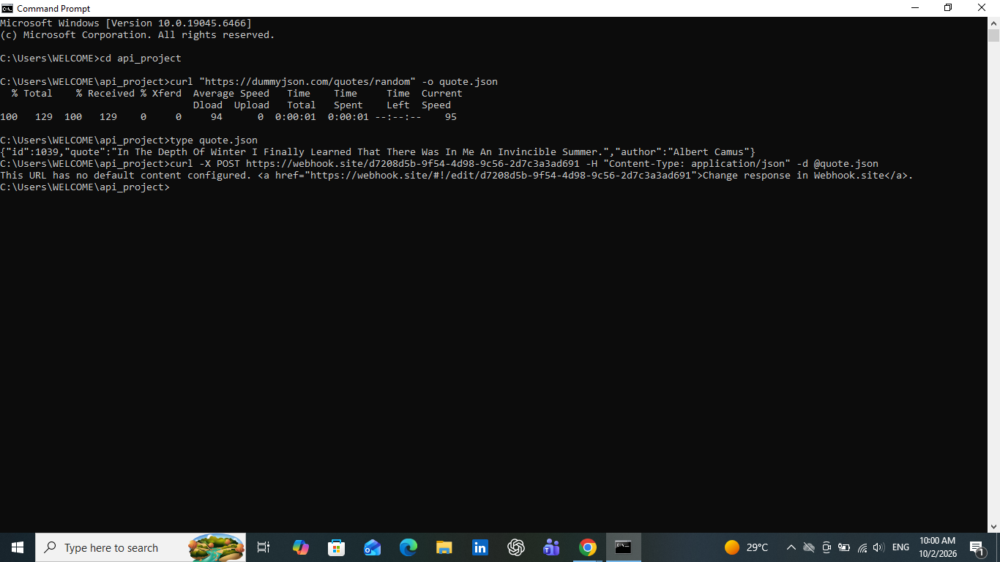
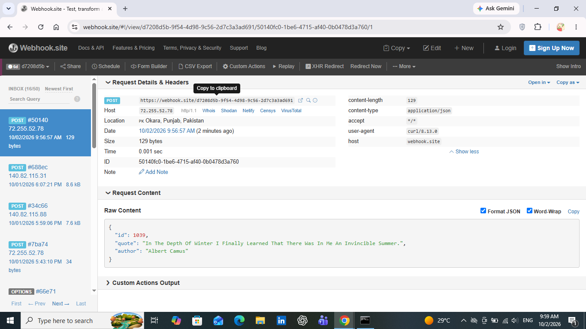

# API Explorer

A small project where I call a free public API, save the response to a file, and then send that data as a test webhook to see what the receiver gets. Everything is done with `curl` in Windows Command Prompt, so no programming language or extra tools are needed.

## What this project does

1. Calls a free public API and gets a random quote.
2. Saves the API response to a file called `quote.json`.
3. Sends the saved data as a `POST` webhook to [webhook.site](https://webhook.site).
4. Inspects the request on webhook.site to see the payload, headers and method.

## API used

**DummyJSON Quotes API**: `https://dummyjson.com/quotes/random`

It is free and needs no signup or API key. Each call returns a random quote as JSON with three fields: `id`, `quote` and `author`.

## Commands

**1. Call the API and save the response to a file**

```
curl "https://dummyjson.com/quotes/random" -o quote.json
```

`-o quote.json` tells curl to write the response into that file instead of printing it.

**2. Check the saved file**

```
type quote.json
```

**3. Send the saved data as a test webhook**

```
curl -X POST https://webhook.site/d7208d5b-9f54-4d98-9c56-2d7c3a3ad691 -H "Content-Type: application/json" -d @quote.json
```

- `-X POST` sends a POST request
- `-H "Content-Type: application/json"` tells the receiver the body is JSON
- `-d @quote.json` uses the contents of the file as the request body

## Step 1 result: API call and saved file



In the terminal screenshot:

- The first `curl` call downloaded **129 bytes** from the API and saved them to `quote.json`.
- `type quote.json` shows the saved response:

```json
{"id":1039,"quote":"In The Depth Of Winter I Finally Learned That There Was In Me An Invincible Summer.","author":"Albert Camus"}
```

- The second `curl` command sent this file to webhook.site. The message "This URL has no default content configured" is webhook.site's default reply. It is not an error, it means the request was received.

## Step 2 result: what the webhook receiver got



On webhook.site the request appeared as a new entry in the inbox with these details:

| Field | Value |
|---|---|
| Method | POST |
| Protocol | HTTP/1.1 |
| Size / Content-Length | 129 bytes |
| Content-Type | application/json |
| Accept | */* |
| User-Agent | curl/8.13.0 |
| Host | webhook.site |
| Time taken | 0.001 sec |

**Request body (Raw Content):**

```json
{
  "id": 1039,
  "quote": "In The Depth Of Winter I Finally Learned That There Was In Me An Invincible Summer.",
  "author": "Albert Camus"
}
```

The body received by webhook.site is exactly the same JSON that the API returned, and its size (129 bytes) matches the size of `quote.json`.

## What I learned

- An API gives you data when you ask for it (you pull the data).
- A webhook sends data to a URL when something happens (the data is pushed to the receiver).
- The same JSON data can be fetched from an API, saved to a file, and then sent onward as a webhook payload without being changed.
- The receiver can see details about the sender in the headers. For example, the `User-Agent: curl/8.13.0` header shows the request was sent using curl.
- `curl` is enough to test both APIs and webhooks quickly from the command line.
- webhook.site is a handy free tool to see exactly what headers and body a webhook request contains.

## Files in this repo

- `README.md`: this file
- `quote.json`: the saved API response
- `cmd.PNG`: Command Prompt screenshot
- `webhook.PNG`: webhook.site screenshot
